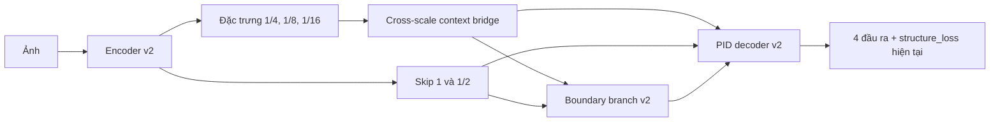

# PID-UNet v10: phát triển trực tiếp từ v2

Tên train: **`pid_unet_v10`**. Model có **960.013 tham số**, train hoàn toàn từ
đầu, dùng nguyên loss và quy trình của v2. Đây là ứng viên mới dựa trên phân tích
checkpoint v8/v9; **chưa có benchmark chứng minh vượt EDANet**.

## Bằng chứng dẫn đến thay đổi

Đã nạp strict hai checkpoint người dùng cung cấp, epoch 90, và chạy lại đủ 60
ảnh CVC-300. Cả 10 chỉ số khớp ảnh kết quả Colab đến 4 chữ số thập phân.

| CVC-300 | v8 | v9 | EDANet trong PDF được cung cấp |
|---|---:|---:|---:|
| mDice ↑ | 0.8349 | 0.8139 | 0.848 |
| mIoU ↑ | 0.7478 | 0.7261 | 0.758 |
| Precision ↑ | 0.7760 | 0.7612 | Không có trong bảng tham chiếu |
| Recall ↑ | 0.9570 | 0.9301 | Không có trong bảng tham chiếu |
| MAE ↓ | 0.0143 | 0.0169 | 0.014 |

v8 có 56/60 ảnh dự đoán diện tích lớn hơn GT; tổng FP/FN là 5,92.
Các ảnh 204–208 cho thấy một dải sáng dài sát GT bị nhận nhầm thành foreground.
Ở 208.png, recall vẫn 0,9732 nhưng diện tích dự đoán bằng 14,51 lần GT,
làm Dice chỉ còn 0,1255. Lỗi xuất hiện cả ở đầu ra thô.

42,1% pixel FP của v8 có sigmoid trên 0,95. Min-max normalization chỉ đổi nhãn
23 pixel trên cả 60 ảnh; chẩn đoán này không ủng hộ việc chỉ sửa normalization.
v9 còn tăng số pixel bỏ sót từ 32.519 lên 60.704. Một seed chưa đủ để quy toàn
bộ sự suy giảm cho InstanceNorm, nhưng chưa có bằng chứng để tiếp tục thay BN.

## Thay đổi kiến trúc

Giữ toàn bộ stem, encoder, BatchNorm, bottleneck, PID blocks, boundary branch
và bốn segmentation heads của v2. Thêm **một cross-scale context bridge** giữa
encoder và boundary/decoder:

1. Chiếu đặc trưng ở 1/4, 1/8, 1/16 về 64 kênh, căn chỉnh về mức 1/4 rồi kết hợp.
2. Hai block trộn thông tin cục bộ bằng depthwise convolution và thông tin xa
   bằng pooled spatial attention. Mỗi vị trí truy vấn tối đa 85 token không gian
   từ các lưới 8×8, 4×4, 2×2, 1×1. Không dùng mask dự đoán để chọn token.
3. Trả các residual đặc trưng về cả ba mức trước khi dự đoán boundary và chạy PID.
   Điều này cho phép sửa bằng chứng ngữ nghĩa ngay trước đầu ra thô, rồi truyền
   đến các đầu ra chi tiết.



Các projection trả residual khởi tạo bằng 0, nên v10 bắt đầu với đúng hàm và
trọng số ngẫu nhiên của v2 nếu dùng cùng seed. Đây là cách khởi tạo, không phải
cam kết giữ độ chính xác v2 sau train. Các lớp bên trong bridge nhận gradient
sau khi projection thoát khỏi 0. `PIDUNetV10(context_bridge=False)` tạo đúng
kiến trúc v2 để làm ablation; không dùng checkpoint khác kiến trúc với `--resume`.

Pooling attention tham khảo [P2T](https://arxiv.org/abs/2106.12011), còn phép trộn
cục bộ trong nhánh attention liên quan đến [SegFormer](https://arxiv.org/abs/2105.15203).
Đây là bản thích nghi nhỏ cho CNN PID, không phải tái hiện hai mạng đó hoặc khẳng
định phát minh một attention mới. LayerNorm chỉ được thêm trong bridge, theo
chiều kênh từng pixel; BatchNorm của v2 được giữ nguyên.

## Cách train

Dùng [notebook v10](pid_unet_v10_colab.ipynb) để mount Drive, lưu best/last,
log, cấu hình và kết quả. Notebook hỗ trợ resume và lưu mã commit của lần chạy.

```python
!git pull --ff-only origin main
!python train.py --model pid_unet_v10 --loss structure_loss --seeds 42
```

Nếu đã mount Drive, nên dùng:

```python
!python train.py --model pid_unet_v10 --loss structure_loss --seeds 42 --output_root /content/drive/MyDrive/polyp_runs
```

Giữ AdamW lr=0.0003, weight decay=0.0001, 100 epochs, batch 8, warmup 5,
cosine schedule, stochastic multiscale và split validation hiện tại.
Loss vẫn là tổng structure_loss của 4 heads cộng boundary supervision hiện tại
với trọng số 0,2. Không thêm loss, dữ liệu ngoài, pretrained weights hay TTA.

Khởi đầu một run mới. Khi tiếp tục run v10 bị ngắt, dùng cùng cấu hình và
`--resume /content/drive/MyDrive/polyp_runs/snapshots/pid_unet_v10/last.pth`.

## Chi phí và kiểm tra

| Model | Parameters | Ước tính GMAC ở 352×352 |
|---|---:|---:|
| v2 | 835.373 | 6,6414 |
| v10 | 960.013 | 7,3654 |

Bridge thêm 124.640 tham số, ước tính MAC tăng 10,9%. Bộ đếm được bổ sung hai
matrix products của attention mà THOP thường bỏ qua. Cột `FLOPs (G)` cũ trong
pipeline thực chất dùng quy ước MAC của THOP; đây là ước tính và chưa đếm mọi
phép toán elementwise/interpolation. Không suy ra FPS T4 từ MAC.

Kiểm tra gồm: đầu ra ban đầu bằng v2; ablation; kích thước multiscale và ảnh
chữ nhật; đường truyền thông tin xa; gradient qua trainer/loss hiện tại;
mixed precision; batch cuối có một ảnh; checkpoint round-trip và chặn checkpoint
khác kiến trúc; profiler tính attention. Máy local chỉ có CPU, nên mixed precision
đã kiểm tra bằng BF16, chưa xác nhận CUDA FP16/T4 hoặc độ chính xác sau 100 epochs.

Kết quả kiểm tra ngày 15/11/2026: 38 tests đạt, 1 test CUDA của v2 Plus được bỏ
qua vì không có GPU. Cả 9 tests v10 đạt. Lượt học kiểm tra 32 bước trên 16 ảnh
thuộc phần train (đã loại 145 ảnh validation theo split seed 42), ở 96×96 với
augmentation/multiscale tắt, giảm loss từ 6,5806 xuống 4,4838; gradient attention
hữu hạn và khác 0. Lượt này chỉ xác nhận vận hành, không đo generalization hoặc
so sánh độ chính xác với v2/EDANet.

## Điều kiện đánh giá

Chọn checkpoint bằng validation của TrainDataset. Kiểm tra ưu tiên giảm FP với
recall được duy trì, nhất là các mask chiếm diện tích nhỏ trong validation.
Không dùng ảnh/GT CVC-300 để train, đặt ngưỡng, chọn epoch hoặc tìm hyperparameter.
Phân tích test đã tác động đến giả thuyết kiến trúc, nên cần công bố điều này và
thêm đánh giá độc lập trước khi kết luận trong paper.

Sau khi train xong, đối chiếu **cả 5 tập**:

```bash
python compare_edanet.py --metrics /content/drive/MyDrive/polyp_runs/results/pid_unet_v10/metrics.csv
```

Mốc Dice CVC-300 từ bảng EDANet là 0,848; v2 người dùng báo cáo là 0,8294.
Giá trị PDF đã làm tròn, cần khớp split, preprocessing và định nghĩa metric.
Sm/Em/wFb hiện tại vẫn cần kiểm chứng bằng implementation tham chiếu. PDF không
có Recall, Precision, Specificity, HD95, wFb để kết luận vượt ở các chỉ số đó.
Report nhiều seed và tất cả tập, kể cả các chỉ số giảm; chưa gọi v10 là tốt nhất.
